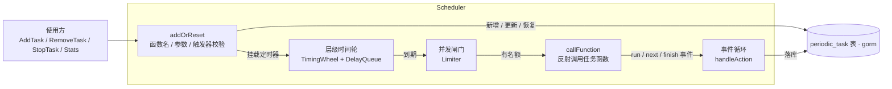
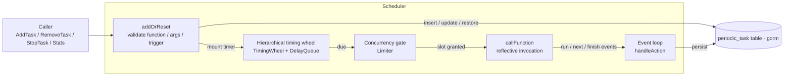

# scheduler

[](https://github.com/angYuHao/scheduler/blob/master/LICENSE)

[中文](#中文说明) | [English](#english)

基于**层级时间轮**的 Go 定时任务调度器：支持任务持久化、可插拔自定义触发器、全局并发控制与运行统计。

A cron-style Go job scheduler built on a **hierarchical timing wheel**, with optional
database persistence, pluggable custom triggers, global concurrency control and
runtime statistics.

---

## 中文说明

### 特性

- **三种内置触发器**：`date`（单次）、`interval`（固定间隔）、`cron`（cron 表达式，支持 5~7 字段与 L/W/# 扩展）
- **自定义触发器**：实现 `Trigger` 接口即可注册任意多种类型，或直接注入实例免注册
- **存储模式可选**：内存模式（重启丢失）或落库模式（gorm，重启自动恢复）
- **并发控制**：单任务级 `LimitedAliveCount` + 全局 `MaxConcurrency`，满载可排队或跳过
- **运行统计**：待执行 / 正在执行 / 已暂停任务数，并发上限调整即时生效
- **添加期校验**：函数名、参数个数与类型、触发器配置在 `AddTask` 阶段即校验，非法任务不落库

### 项目架构

```
scheduler/
├── schedule.go        # 调度器门面：任务增删改查、存储模式、事件循环、持久化
├── trigger.go         # Trigger 接口、内置三种触发器、自定义类型注册表
├── limiter.go         # 全局并发闸门（可动态调整，广播唤醒等待者）
├── timingwheel.go     # 层级时间轮（移植自 nsq 的实现思路）
├── bucket.go          # 时间轮槽位与 Timer
├── delayqueue.go      # 最小堆 + 延迟队列（移植自 nsq）
├── args_type.go       # Args（JSON 序列化）与 SafeMapOfInt 计数表
├── utils.go           # 时间截断、WaitGroup 封装等小工具
└── cronexpr*.go       # cron 表达式解析与计算（移植自 gorhill/cronexpr，MIT）
```



**执行流程**

1. `AddTask`：函数符号名校验 → 参数个数与类型校验 → 触发器 `Build` 校验 → 落库 → 挂载到时间轮
2. 时间轮到期：先按触发器计算并挂载**下一次**执行（调度不因执行阻塞而漂移），再申请并发名额
3. `callFunction`：申请全局名额 → 同步维护运行计数 → 反射调用 → defer 统一释放名额、回收计数、按需上报结束事件
4. 生命周期事件（`run` / `next_run` / `finish`）由独立事件循环统一落库，失败仅记日志不影响执行
5. `Stop`：关闭退出通道 → 时间轮停止 → 等待内部 goroutine 退出（不等待正在执行的任务）

**关键设计**

| 设计点 | 说明 |
| --- | --- |
| 触发器 | `Type / Next / Build` 三方法接口；落库存类型名 + 配置串，重启按注册的原型重建 |
| 存储模式 | 启动时经 `Options.Storage` 显式选定；接口字段不能作为数据库列，故持久化字符串 |
| 函数注册 | 任务落库的是 `包路径.类型名.方法名`，重启后据此在反射注册表中找回函数 |
| 并发统计 | 运行计数在执行路径上**同步**维护（事件循环是异步的），保证统计与限流判断准确 |
| 死代码防护 | 单次任务执行完毕与循环任务越过结束时间时都会打停止标记，不污染待执行统计 |

### 快速开始

```bash
go get github.com/angYuHao/scheduler
go build ./...
```

依赖：`gorm.io/gorm`、`github.com/sirupsen/logrus`、`github.com/spf13/cast`、`github.com/glebarez/sqlite`（仅测试）。

### 选择存储模式

启动时通过 `Options.Storage` 显式选择：内存模式（不落库，重启丢失）或落库模式（写入 `periodic_task` 表，重启可恢复）。

```go
// 内存模式：任务不落库，即使传入 DB 也会被忽略
s, err := scheduler.NewSchedulerWithOptions(scheduler.Options{
	Storage:   scheduler.StorageMemory,
	DB:        nil,         // 内存模式下无需 DB
	Tick:      time.Second, // 为 0 时默认 1s
	WheelSize: 24,          // 为 0 时默认 24
})

// 落库模式：必须提供 DB
s, err = scheduler.NewSchedulerWithOptions(scheduler.Options{
	Storage:   scheduler.StorageDB,
	DB:        db, // gorm 连接，为 nil 时返回错误
	Tick:      time.Second,
	WheelSize: 24,
})
s.Start()
fmt.Println(s.Mode()) // memory / db
```

也可继续用旧签名（按 `db` 是否为 nil 隐式选择，行为不变）：

```go
// db：gorm 的数据库连接，为 nil 时为内存模式，重启后任务数据将清空
// tick：时间轮切片精度，一般设置为 time.Second
// wheelSize：时间轮槽位数
scheduler.NewScheduler(db *gorm.DB, tick time.Duration, wheelSize int64)
// 例：scheduler.NewScheduler(nil, time.Second, 24)
```

### 启动与停止

```go
s.Start() // 幂等；必须先 Start 再 AddTask
defer s.Stop()
```

> 注意：`Start` 之前调用 `AddTask` 会直接返回错误（内部事件通道此时没有消费者）。

### 注册函数方法

将结构体方法注册到调度器，任务落库的是函数名字符串，重启后据此找回函数。

```go
type T struct{}

func (t T) A()                              {}
func (t T) B(b string, i int)               {}
func (t T) C(b string, i int, c interface{}) {}

// 注册 T 下所有方法
scheduler.AddTaskFunction(&T{})
```

**Function 必须用「值接收者 + 方法表达式」**，这是硬性约束。注册 key 由 `包路径 + 类型名 + 方法名` 拼接而成，而任务的 `Function` 存的是 `runtime.FuncForPC` 拿到的符号名，两套命名体系在下列情况会分叉（分叉的写法在 `AddTask` 阶段即报错，不会静默失败）：

| 写法 | 符号名 | 结果 |
| --- | --- | --- |
| `T.A`（值接收者方法表达式） | `pkg.T.A` | 正常 |
| `Outer.A`（嵌入提升后） | `pkg.Outer.A` | 正常 |
| `tk.A`（绑定方法值） | `pkg.T.A-fm` | `AddTask` 报错 |
| `(*T).A`（指针接收者） | `pkg.(*T).A` | `AddTask` 报错 |
| `(&Outer{}).A`（嵌入 + 绑定方法值） | `pkg.Inner.A-fm` | `AddTask` 报错 |
| 匿名函数 | `pkg.main.func1` | `AddTask` 报错 |

```go
type Inner struct{}

func (Inner) Run() {} // 值接收者

type Outer struct{ Inner }

func (Outer) Own() {} // 自己的方法

s.AddTaskFunction(&Outer{})
s.AddTask("a", scheduler.PeriodicTask{Function: Outer.Run})    // OK：嵌入提升，方法表达式
s.AddTask("b", scheduler.PeriodicTask{Function: Outer.Own})    // OK
s.AddTask("c", scheduler.PeriodicTask{Function: (&Outer{}).Run}) // 报错：绑定方法值
```

由于不能绑定实例，同一类型的所有任务共享同一份配置，差异化参数请通过 `Args` 传递；函数名变更会导致已落库任务在重启后找不到函数，务必保持稳定。

**参数校验**：函数已注册时，`Args` 的个数与类型在 `AddTask` 阶段即校验（个数不符、类型不可赋值、nil 赋给不可空形参均报错且不落库）；执行期还会兜底复检一次（数据库恢复的 `Args` 经 JSON 反序列化后类型可能变化）。基础类型形参按 cast 语义宽松转换（数字/字符串互转、nil 转零值），其余类型要求 `AssignableTo` 形参。可变参数函数不支持，超出固定形参个数即报错。

### 并发控制与运行统计

```go
s, err := scheduler.NewSchedulerWithOptions(scheduler.Options{
	Storage:           scheduler.StorageMemory,
	Tick:              time.Second,
	MaxConcurrency:    10,                          // 全局同时执行上限，<=0 不限
	ConcurrencyPolicy: scheduler.ConcurrencyBlock, // 满载时排队等待（默认）
})
if err != nil {
	panic(err)
}
s.Start()
defer s.Stop()

// 运行统计
st := s.Stats()
// st.Total          内存中任务总数（含已暂停）
// st.Pending        待执行任务数（已启用、未暂停）
// st.Stopped        已暂停任务数
// st.Running        正在执行的任务数（按任务去重）
// st.Instances      正在执行的实例总数（含同一任务多次并发）
// st.MaxConcurrency 当前并发上限
// st.Skipped        因并发满被跳过的累计次数

fmt.Println(s.PendingCount()) // 待执行任务数
fmt.Println(s.ActiveCount())  // 正在执行的任务数

// 运行时动态调整上限，立即生效（缩限不会中断正在执行的任务）
s.SetMaxConcurrency(20)
fmt.Println(s.MaxConcurrency())
```

两种满载策略：

| 策略 | 行为 | 适用场景 |
| --- | --- | --- |
| `ConcurrencyBlock`（默认） | 排队等待空闲名额，不丢任务 | 任务不可丢，如订单处理、报表生成 |
| `ConcurrencySkip` | 直接跳过本次执行，计入 `Stats().Skipped` | 允许丢弃的轮询类任务 |

`PeriodicTask.LimitedAliveCount` 仍是单任务级的并发上限，`MaxConcurrency` 是全局上限，两者同时生效，取更严格者。

### 自定义触发器

内置三种触发器：`date`（单次）、`interval`（固定间隔）、`cron`（cron 表达式）。可注册任意多个自定义类型：实现 `Trigger` 接口（`Type`/`Next`/`Build`）+ `RegisterTrigger` 注册零值原型，之后 `PeriodicTask.TriggerType` 填注册名、`TriggerConfig` 填配置串。

也可跳过注册，直接注入触发器实例（`PeriodicTask.Trigger`），类型名自动取实例的 `Type()`。

```go
// 自定义触发器：Type 返回类型名，Build 由任务配置产出真实例
type stepTrigger struct{ Step time.Duration }

func (t *stepTrigger) Type() string                  { return "step" }
func (t *stepTrigger) Next(prev time.Time) time.Time { return prev.Add(t.Step) }
func (t *stepTrigger) Build(p scheduler.PeriodicTask) (scheduler.Trigger, error) {
	d, err := time.ParseDuration(p.TriggerConfig)
	if err != nil {
		return nil, err
	}
	return &stepTrigger{Step: d}, nil
}

// 注册（可注册多个不同类型）
scheduler.RegisterTrigger("step", &stepTrigger{})

// 方式一：按类型名 + 配置串
s.AddTask("by-name", scheduler.PeriodicTask{
	Function:      T.A,
	TriggerType:   "step",
	TriggerConfig: "30s",
})

// 方式二：直接注入实例（免注册）
s.AddTask("by-instance", scheduler.PeriodicTask{
	Function: T.A,
	Trigger:  &stepTrigger{Step: 30 * time.Second},
})
```

持久化（启用数据库时）：接口实例不能作为数据库列，故落库的是 `trigger` 列（类型名）与 `trigger_config` 列（配置串），重启后按类型名查找原型自动重建；未注册的类型名在 `AddTask` 阶段即报错，不会落库。

### 任务支持的功能

```go
type T struct{}

func (t T) A()                              {}
func (t T) B(b string, i int)               {}
func (t T) C(b string, i int, c interface{}) {}

func main() {
	s := scheduler.NewScheduler(nil, time.Second, 24)
	s.AddTaskFunction(&T{})
	s.Start()
	defer s.Stop()
	// 创建 date 任务，该任务只执行一次
	err := s.AddTask("test1", scheduler.PeriodicTask{
		Name:              "测试任务1",
		Function:          T.A,
		Args:              scheduler.Args{},
		StartTime:         time.Now(),
		TriggerType:       scheduler.Date,
		LimitedAliveCount: 1,
	})
	if err != nil {
		fmt.Println(err)
	}
	// 创建 interval 任务，该任务循环执行
	err = s.AddTask("test2", scheduler.PeriodicTask{
		Name:              "测试任务2",
		Function:          T.B,
		Args:              scheduler.Args{"test2", 1},
		StartTime:         time.Now(),
		TriggerType:       scheduler.Interval,
		Interval:          "5s",
		LimitedAliveCount: 1,
	})
	if err != nil {
		fmt.Println(err)
	}
	// 创建 cron 任务，该任务为计划任务
	err = s.AddTask("test3", scheduler.PeriodicTask{
		Name:              "测试任务3",
		Function:          T.C,
		Args:              scheduler.Args{"test2", 1, "测试任务3"},
		StartTime:         time.Now(),
		TriggerType:       scheduler.Cron,
		Cron:              "*/5 * * * * * *",
		LimitedAliveCount: 1,
	})
	if err != nil {
		fmt.Println(err)
	}
	// 更新任务 test1
	err = s.ResetTask("test1", scheduler.PeriodicTask{
		Name:              "测试任务2",
		Function:          T.B,
		Args:              scheduler.Args{"test2", 1},
		StartTime:         time.Now(),
		TriggerType:       scheduler.Interval,
		Interval:          "5s",
		LimitedAliveCount: 1,
	})
	if err != nil {
		fmt.Println(err)
	}
	// 暂停任务 test1
	err = s.StopTask("test1")
	if err != nil {
		fmt.Println(err)
	}
	// 继续任务 test1
	err = s.ContinueTask("test1")
	if err != nil {
		fmt.Println(err)
	}
	// 立刻执行任务 test1
	err = s.StartTaskNow("test1")
	if err != nil {
		fmt.Println(err)
	}
	for {
		time.Sleep(time.Hour)
	}
}
```

### 测试

```bash
gofmt -l .                            # 格式检查
go vet ./...                          # 静态检查
go test -short -count=1 -race ./...   # 回归测试（-short 跳过长耗时演示用例）
```

注释约定：所有导出 API 与关键逻辑均为中英双语；`cronexpr*.go` 为第三方实现，仅保留文件级来源说明。

---

## English

A Go job scheduler built on a **hierarchical timing wheel**, with optional database
persistence, pluggable custom triggers, global concurrency control and runtime
statistics.

### Features

- **Three built-in triggers**: `date` (one-shot), `interval` (fixed interval), `cron`
  (5~7 fields, with `L`/`W`/`#` extensions)
- **Custom triggers**: implement the `Trigger` interface and register as many types as
  you like, or inject an instance directly to skip registration
- **Selectable storage**: in-memory (lost on restart) or gorm-backed (auto-restored)
- **Concurrency control**: per-job `LimitedAliveCount` plus a global `MaxConcurrency`;
  overflow can queue or skip
- **Runtime stats**: pending / running / paused job counts; the concurrency limit can
  be resized at runtime
- **Fail-fast validation**: function names, argument arity/types and trigger
  configuration are validated in `AddTask`; invalid jobs never reach the database

### Architecture

| File | Responsibility |
| --- | --- |
| `schedule.go` | Scheduler facade: job CRUD, storage modes, event loop, persistence |
| `trigger.go` | `Trigger` interface, three built-ins, custom type registry |
| `limiter.go` | Global concurrency gate (resizable, broadcasts to wake waiters) |
| `timingwheel.go` / `bucket.go` / `delayqueue.go` | Hierarchical timing wheel, buckets, delay queue (ported from nsq) |
| `args_type.go` | `Args` (JSON serialization) and `SafeMapOfInt` counters |
| `utils.go` | Small helpers: time truncation, WaitGroup wrapper |
| `cronexpr*.go` | Cron expression parsing/evaluation (ported from gorhill/cronexpr, MIT) |



**Execution flow**

1. `AddTask`: validate the function symbol name → validate argument arity/types →
   build the trigger → persist → mount on the timing wheel
2. When the wheel fires, the **next** occurrence is scheduled first (so a blocked
   execution never drifts the schedule), then a concurrency slot is requested
3. `callFunction`: acquire a global slot → maintain the running counter
   synchronously → invoke reflectively → the deferred cleanup releases the slot,
   recovers the counter and reports the finish event when needed
4. Lifecycle events (`run` / `next_run` / `finish`) are persisted by a dedicated event
   loop; persistence failures are logged only and never affect execution
5. `Stop`: close the exit channel → stop the wheel → wait for internal goroutines
   (running jobs are not awaited)

**Key design decisions**

| Decision | Rationale |
| --- | --- |
| Trigger interface | `Type / Next / Build`; only the type name + config string are persisted, and the registered prototype rebuilds the instance on restart |
| Storage mode | Chosen explicitly via `Options.Storage` at startup; interface fields cannot be database columns, so strings are persisted instead |
| Function registry | Jobs persist `pkgpath.Type.Method` and the reflective registry resolves it back after restart |
| Concurrency stats | Running counters are updated **synchronously** on the execution path (the event loop is async) so stats and limiting stay accurate |
| Stale-state hygiene | One-shot jobs and repeating jobs that pass their end time are flagged as stopped so they never pollute the pending count |

### Quick start

```bash
go get github.com/angYuHao/scheduler
go build ./...
```

Dependencies: `gorm.io/gorm`, `github.com/sirupsen/logrus`, `github.com/spf13/cast`,
`github.com/glebarez/sqlite` (tests only).

### Choosing a storage mode

```go
// Memory mode: nothing is persisted; a provided DB is ignored
s, err := scheduler.NewSchedulerWithOptions(scheduler.Options{
	Storage:   scheduler.StorageMemory,
	DB:        nil,         // not needed in memory mode
	Tick:      time.Second, // 0 means the default 1s
	WheelSize: 24,          // 0 means the default 24
})

// DB mode: a gorm connection is required
s, err = scheduler.NewSchedulerWithOptions(scheduler.Options{
	Storage:   scheduler.StorageDB,
	DB:        db, // nil returns an error
	Tick:      time.Second,
	WheelSize: 24,
})
s.Start()
fmt.Println(s.Mode()) // memory / db
```

The legacy constructor still works (storage mode inferred from `db`):

```go
// db: gorm connection; nil means memory mode where jobs are lost on restart
// tick: wheel precision, usually time.Second
// wheelSize: number of wheel buckets
scheduler.NewScheduler(db *gorm.DB, tick time.Duration, wheelSize int64)
// e.g. scheduler.NewScheduler(nil, time.Second, 24)
```

### Start and stop

```go
s.Start() // idempotent; call Start before AddTask
defer s.Stop()
```

> Calling `AddTask` before `Start` returns an error immediately (the internal event
> channel has no consumer yet).

### Registering functions

Register struct methods so that jobs can invoke them by name; only the name is
persisted and resolved again after a restart.

```go
type T struct{}

func (t T) A()                              {}
func (t T) B(b string, i int)               {}
func (t T) C(b string, i int, c interface{}) {}

// Register all methods of T
scheduler.AddTaskFunction(&T{})
```

**`Function` must be a value-receiver method expression** — this is a hard
requirement. Registry keys are built from `pkgpath + type + method`, while jobs store
the symbol name reported by `runtime.FuncForPC`; the two naming schemes diverge in the
cases below (divergent forms are rejected in `AddTask` instead of failing silently):

| Form | Symbol name | Result |
| --- | --- | --- |
| `T.A` (value receiver, method expression) | `pkg.T.A` | OK |
| `Outer.A` (promoted through embedding) | `pkg.Outer.A` | OK |
| `tk.A` (bound method value) | `pkg.T.A-fm` | rejected |
| `(*T).A` (pointer receiver) | `pkg.(*T).A` | rejected |
| `(&Outer{}).A` (embedded + bound value) | `pkg.Inner.A-fm` | rejected |
| anonymous function | `pkg.main.func1` | rejected |

```go
type Inner struct{}

func (Inner) Run() {} // value receiver

type Outer struct{ Inner }

func (Outer) Own() {} // Outer's own method

s.AddTaskFunction(&Outer{})
s.AddTask("a", scheduler.PeriodicTask{Function: Outer.Run})      // OK
s.AddTask("b", scheduler.PeriodicTask{Function: Outer.Own})      // OK
s.AddTask("c", scheduler.PeriodicTask{Function: (&Outer{}).Run}) // rejected
```

Because instances cannot be bound, all jobs of one type share the same configuration;
pass per-job differences through `Args`. Renaming functions breaks persisted jobs
after a restart, so keep names stable.

**Argument validation**: when the function is registered, `Args` arity and types are
validated in `AddTask` (wrong count, non-assignable types and `nil` passed to
non-nilable parameters are rejected without persisting); the runtime re-checks as a
safety net because `Args` restored from JSON may change type. Basic-type parameters
convert leniently via `cast` (numbers/strings interchange, `nil` becomes the zero
value); everything else must be `AssignableTo` the parameter. Variadic functions are
not supported.

### Concurrency control and stats

```go
s, err := scheduler.NewSchedulerWithOptions(scheduler.Options{
	Storage:           scheduler.StorageMemory,
	Tick:              time.Second,
	MaxConcurrency:    10,                          // global limit, <=0 unlimited
	ConcurrencyPolicy: scheduler.ConcurrencyBlock, // queue when full (default)
})
if err != nil {
	panic(err)
}
s.Start()
defer s.Stop()

st := s.Stats()
// st.Total          jobs in memory (including paused)
// st.Pending        enabled, non-paused jobs
// st.Stopped        paused jobs
// st.Running        running jobs, deduplicated by key
// st.Instances      running executions, including concurrent runs of one job
// st.MaxConcurrency current global limit
// st.Skipped        runs dropped because the limit was reached

fmt.Println(s.PendingCount())
fmt.Println(s.ActiveCount())

// Resize at runtime; shrinking never interrupts running jobs
s.SetMaxConcurrency(20)
fmt.Println(s.MaxConcurrency())
```

Overflow policies:

| Policy | Behaviour | Use case |
| --- | --- | --- |
| `ConcurrencyBlock` (default) | Queue until a slot is free; nothing is lost | Jobs that must not be dropped |
| `ConcurrencySkip` | Drop the run and count it in `Stats().Skipped` | Polling jobs where skips are acceptable |

`PeriodicTask.LimitedAliveCount` remains the per-job cap; `MaxConcurrency` is the
global cap. Both apply, and the stricter one wins.

### Custom triggers

Built-ins: `date` (one-shot), `interval` (fixed interval), `cron`. Register any number
of custom types: implement `Trigger` (`Type`/`Next`/`Build`) and call
`RegisterTrigger` with a zero-value prototype, then set `PeriodicTask.TriggerType` and
`TriggerConfig`. Alternatively inject an instance directly via `PeriodicTask.Trigger`
to skip registration.

```go
type stepTrigger struct{ Step time.Duration }

func (t *stepTrigger) Type() string                  { return "step" }
func (t *stepTrigger) Next(prev time.Time) time.Time { return prev.Add(t.Step) }
func (t *stepTrigger) Build(p scheduler.PeriodicTask) (scheduler.Trigger, error) {
	d, err := time.ParseDuration(p.TriggerConfig)
	if err != nil {
		return nil, err
	}
	return &stepTrigger{Step: d}, nil
}

scheduler.RegisterTrigger("step", &stepTrigger{})

// By name + config string
s.AddTask("by-name", scheduler.PeriodicTask{
	Function:      T.A,
	TriggerType:   "step",
	TriggerConfig: "30s",
})

// Or inject an instance directly
s.AddTask("by-instance", scheduler.PeriodicTask{
	Function: T.A,
	Trigger:  &stepTrigger{Step: 30 * time.Second},
})
```

Persistence (DB mode): trigger instances cannot be database columns, so the `trigger`
column (type name) and `trigger_config` column (config string) are stored; on restart
the prototype is looked up by name and rebuilt. Unknown type names are rejected in
`AddTask` and never persisted.

### Job lifecycle example

```go
type T struct{}

func (t T) A()                              {}
func (t T) B(b string, i int)               {}
func (t T) C(b string, i int, c interface{}) {}

func main() {
	s := scheduler.NewScheduler(nil, time.Second, 24)
	s.AddTaskFunction(&T{})
	s.Start()
	defer s.Stop()

	// One-shot date job
	_ = s.AddTask("test1", scheduler.PeriodicTask{
		Name: "job1", Function: T.A, Args: scheduler.Args{},
		StartTime: time.Now(), TriggerType: scheduler.Date, LimitedAliveCount: 1,
	})
	// Repeating interval job
	_ = s.AddTask("test2", scheduler.PeriodicTask{
		Name: "job2", Function: T.B, Args: scheduler.Args{"test2", 1},
		StartTime: time.Now(), TriggerType: scheduler.Interval,
		Interval: "5s", LimitedAliveCount: 1,
	})
	// Cron job
	_ = s.AddTask("test3", scheduler.PeriodicTask{
		Name: "job3", Function: T.C, Args: scheduler.Args{"test2", 1, "job3"},
		StartTime: time.Now(), TriggerType: scheduler.Cron,
		Cron: "*/5 * * * * * *", LimitedAliveCount: 1,
	})
	// Replace test1
	_ = s.ResetTask("test1", scheduler.PeriodicTask{
		Name: "job2", Function: T.B, Args: scheduler.Args{"test2", 1},
		StartTime: time.Now(), TriggerType: scheduler.Interval,
		Interval: "5s", LimitedAliveCount: 1,
	})
	// Pause / resume / run now
	_ = s.StopTask("test1")
	_ = s.ContinueTask("test1")
	_ = s.StartTaskNow("test1")

	for {
		time.Sleep(time.Hour)
	}
}
```

### Testing

```bash
gofmt -l .                            # formatting
go vet ./...                          # static analysis
go test -short -count=1 -race ./...   # regression tests (-short skips long demos)
```

Comment convention: every exported API and key code path is documented in both
Chinese and English; `cronexpr*.go` is third-party code and carries file-level
provenance comments only.
